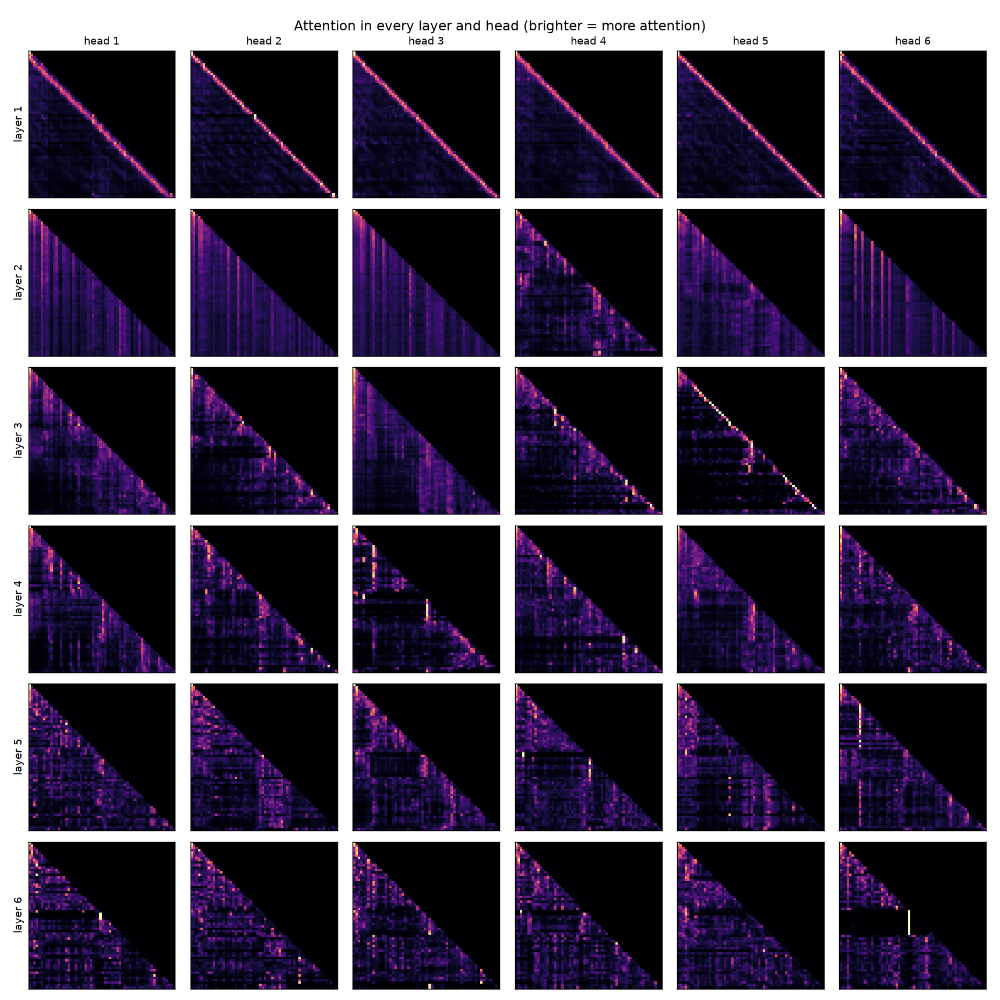
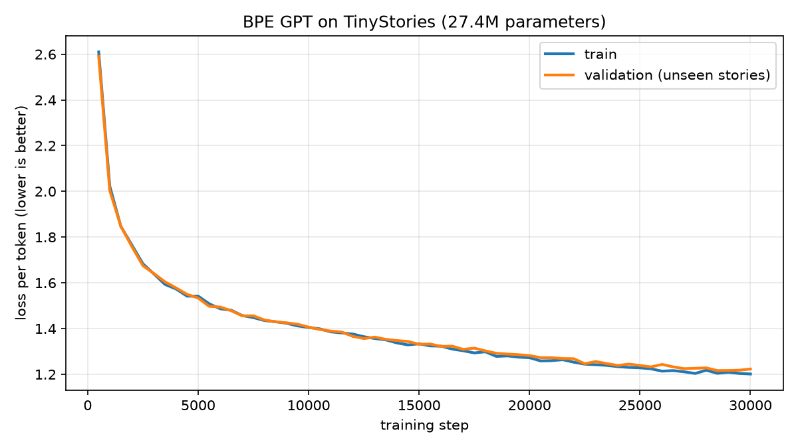

# GPT from scratch

Two GPT-style language models written and trained from the ground up in PyTorch, on a laptop (Apple M5, MPS GPU backend), plus an interactive page where they run in the browser.

**Try it: [gpt.riteshpokharel.com.np](https://gpt.riteshpokharel.com.np)** · trained models on the [releases page](https://github.com/RiteshPokharel/gpt-from-scratch/releases)

| Model | Reads text as | Parameters | Trained on | Training time | Validation loss |
|---|---|---|---|---|---|
| Bigram (baseline) | characters | 4,225 | TinyShakespeare | 6 s | 2.49 per char |
| **Shakespeare GPT** | characters (65) | 10.8M | TinyShakespeare, 1.1M chars | 27 min | **1.48** per char |
| **TinyStories GPT** | BPE tokens (4,097) | 27.4M | TinyStories, 2.7M stories | 7.3 h | **1.22** per token |

Both models follow the decoder-only transformer from [Attention Is All You Need](https://arxiv.org/abs/1706.03762): token + position embeddings, a stack of pre-LayerNorm blocks (multi-head causal self-attention, then an MLP, each with a residual connection), and a final linear layer and softmax over the vocabulary. Everything is written by hand: the attention, the blocks, the training loop and the byte-pair encoding tokenizer. No pretrained weights, no tokenizer libraries.

## The interactive page

`web/` is a static page (plain HTML, CSS and JavaScript, no dependencies) with:

- **A demo.** Pick a model and a starting line and watch it write. Recorded examples play instantly; a custom prompt loads the model (int8 weights, 11 MB / 28 MB) into the browser and runs it there.
- **What happens when you press Generate.** Tokens, embeddings, attention, the next-token probabilities and sampling, on a fixed example per model, with the attention and softmax equations worked through on real numbers.
- **The two models side by side**, and how they learned: loss curves and the stories the TinyStories model wrote every 500 steps of training.

### Running the models in the browser

After training, the TinyStories model is 110 MB of 32-bit numbers and the Shakespeare model 43 MB. That's too much to make a visitor download, so `web/export_browser_model.py` stores each weight matrix in 8 bits instead, with one 32-bit scale per row (LayerNorm weights and biases stay 32-bit). The files shrink to 27.7 MB and 10.9 MB, split into 12 MB parts.

A small engine written in plain JavaScript (`web/js/gpt.js`) runs them: the same forward pass as `model.py`, one token at a time, with a key/value cache so each new token only does the work for itself. It runs in a web worker so the page stays responsive. `node web/js/test_engine.mjs` checks it against PyTorch: the same top prediction on every test prompt, probabilities within half a percentage point. On an M5 it writes about 60 tokens a second.

The model only downloads when a visitor types their own starting line; the built-in examples are recorded with the same engine (`web/record_demo.mjs`).

Run it locally:

```bash
python3 -m http.server -d web 8000     # then open http://localhost:8000
```

## Shakespeare model


Validation loss stopped improving around step 2,000 while training loss kept falling: the model had read its 1M characters about 33 times and was starting to memorise them. The checkpoint with the best validation loss is the one kept.

Generated from the prompt `ROMEO:` at temperature 0.8:

```
ROMEO:
And not a brother than the king shall stay the world:
No foot that thou hast devised me.
And shalt thou call me forth from her duty?

Nurse:
Nay, son, since he cannot live her coat.

ROMEO:
'Tis very rich in mine arms cannot hear her.
Now Capulet! how now, by this speed, the earth doth more flatter
```

### What the attention heads learned

Feeding the line below through the trained model and recording every head's attention weights (`visualize_attention.py`):

```
ROMEO:
Is the day so young?

BENVOLIO:
But new struck nine.
```

In each heatmap, a row is the character doing the looking, a column is the character being looked at, and brighter means more attention. The upper triangle is empty because of the causal mask.


- **Layer 1, head 2: the previous characters.** The bright line just under the diagonal means each character looks at the one or two before it. All six heads in layer 1 do some version of this, which is how the model handles spelling.
- **Layer 2, head 6: spaces and line breaks.** The vertical stripes sit on the spaces and newlines, so this head tracks where the current word started.
- **Layer 6, head 6: inside a speaker's name.** While the model is writing `BENVOLIO:`, every character in the name puts 97–100% of its attention on the blank line just before it. That tells the model it is in the middle of a speaker's name, so it keeps writing capitals until the colon and then starts a new line.

None of these were programmed in. They come out of training to predict the next character.

<details>
<summary>All 36 heads (6 layers × 6 heads)</summary>



Early layers look locally, middle layers latch onto word and line boundaries, and later layers spread their attention over longer distances.
</details>

## TinyStories model

**Tokenizer.** A byte-level BPE tokenizer (`bpe.py`), trained on the first 20 MB of the stories: it starts from the 256 byte values and repeatedly merges the most frequent adjacent pair, 3,840 times, with GPT-2-style pre-splitting so merges never cross word boundaries. That gives 4,096 tokens plus an end-of-story token, at about 3.9 characters per token. `python test_bpe.py` runs its 25 tests.

**Model.** 8 layers, 8 heads, 512-dimensional embeddings, 256-token context (about 1,000 characters), weight tying between the token embedding and the output layer, PyTorch's fused attention.

**Training.** 30,000 steps of 64 × 256 tokens (about 490M tokens, under one pass over the 557M-token training set), AdamW with 500 warmup steps and cosine decay from 6e-4 to 6e-5, gradient clipping at 1.0, bf16 mixed precision. A checkpoint and a sample story are written every 500 steps.

### Results



Validation loss fell from 8.42 (random weights) to 1.22 after 30,000 steps (best 1.216, at step 28,500), and training and validation loss stayed together the whole way: the model saw 491M tokens, about 0.88 passes over the data, so it never had the chance to memorise. In bits per character that is 0.45, against 2.13 for the Shakespeare model; the two datasets are very different (children's stories are far more predictable than Shakespeare), so this compares how well each model learned its own data, not which is the better model.

A story from the final model, prompted with `Once upon a time` (temperature 0.8, top-k 50):

```
Once upon a time, there was a little girl named Lily. She liked to read books. One day, she found a
book with a picture of a cat on it. Lily was so happy!
Lily wanted to show the book to her friend, Tim. So, she went to his house and found him playing
outside. She said, "Look, Tim! This is my new book! Let's read together!" Tim was very excited to see
the book.
They sat under a big tree and opened the book. Lily read the pages out loud, "I like the cat picture.
It has a big, tasty apple!" Tim laughed and said, "I like the picture too! It is fun!" They read the
book together and had a great time.
```

`out/tinystories_samples.txt` has the story it wrote every 500 steps, from noise at step 0 to the one above.

## Files

| File | What it is |
|---|---|
| `bigram.py` | Baseline model: predicts the next character from the current one only |
| `gpt.py` | Character-level GPT and its training loop (Shakespeare) |
| `sample.py` | Generate text from the Shakespeare checkpoint |
| `sample_tinystories.py` | Generate a story from the TinyStories checkpoint |
| `plot_loss.py` | Plot both training curves |
| `visualize_attention.py` | Draw what each attention head looks at |
| `bpe.py`, `test_bpe.py` | Byte-level BPE tokenizer and its tests |
| `model.py` | Configurable GPT used for TinyStories |
| `prepare_tinystories.py` | Train the tokenizer and encode the dataset to token files |
| `train_tinystories.py` | Training loop with warmup, cosine decay, bf16, checkpoints and `--resume` |
| `web/` | The interactive page, the JavaScript engine and the scripts that export data for it |

## Run it

```bash
python -m venv .venv
source .venv/bin/activate
pip install -r requirements.txt

# Shakespeare
python bigram.py                         # baseline, a few seconds
python gpt.py                            # train the GPT (~30 min on an M5)
python sample.py --prompt "JULIET:" --temp 0.8

# TinyStories (download TinyStoriesV2-GPT4-train.txt and -valid.txt into data/tinystories/ first)
python prepare_tinystories.py            # tokenizer + token files, ~2 min
python train_tinystories.py              # ~7 h on an M5; Ctrl+C is safe, then --resume
python sample_tinystories.py --prompt "The little girl"
```

### Use the trained models without training

Download from the [releases page](https://github.com/RiteshPokharel/gpt-from-scratch/releases): `shakespeare.pt` (45 MB), `tinystories.pt` (110 MB, weights only) and `tokenizer.json`. Put the `.pt` files in `out/` and `tokenizer.json` in `data/tinystories/`, then:

```bash
python sample.py --prompt "ROMEO:" --temp 0.8
python sample_tinystories.py --prompt "Once upon a time"
```

## Data

- [TinyShakespeare](https://github.com/karpathy/char-rnn/tree/master/data/tinyshakespeare), about 1.1 million characters, in `data/shakespeare.txt`.
- [TinyStories](https://arxiv.org/abs/2305.07759) (Eldan and Li, 2023), version 2: 2.7 million short stories in simple English, about 2.2 GB of text.
