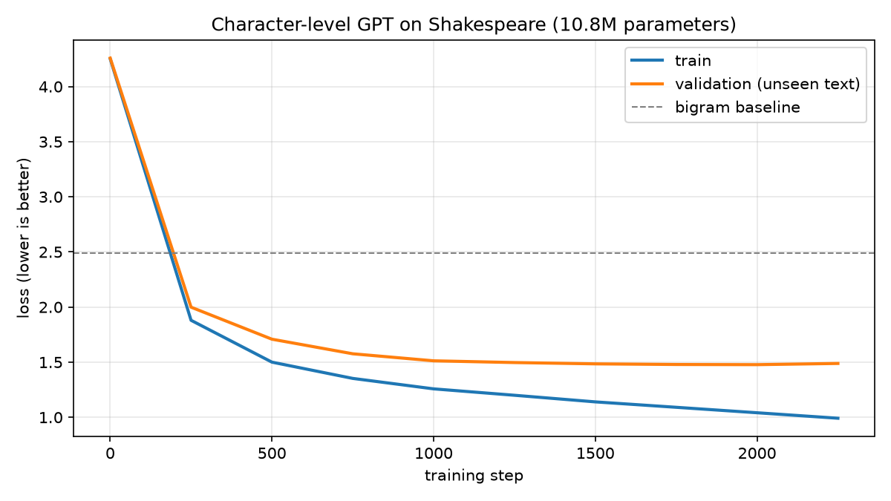
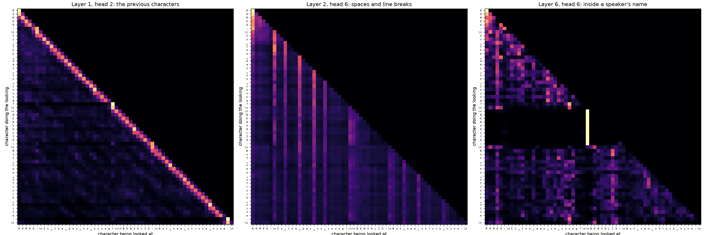

# GPT from scratch

A small GPT-style language model, written and trained from the ground up in PyTorch, on a laptop (Apple M5, using the MPS GPU backend).

The first version is a character-level model trained on the works of Shakespeare. A larger model with a byte-pair encoding tokenizer, trained on the TinyStories dataset, is next.

## Results

| Model | Parameters | Training time | Validation loss |
|---|---|---|---|
| Bigram (baseline) | 4,225 | 6 s | 2.49 |
| GPT | 10.8M | 27 min | **1.48** |



Validation loss stopped improving around step 2,000 while training loss kept falling, so the model was starting to overfit. The checkpoint with the best validation loss is the one kept.

### Sample

Generated from the prompt `ROMEO:` at temperature 0.8:

```
ROMEO:
And not a brother than the king shall stay the world:
No foot that thou hast devised me.
And shalt thou call me forth from her duty?

Nurse:
Nay, son, since he cannot live her coat.

ROMEO:
'Tis very rich in mine arms cannot hear her.
Now Capulet! how now, by this speed, the earth doth more flatter
```

## What the attention heads learned

Feeding the line below through the trained model and recording every head's attention weights (`visualize_attention.py`):

```
ROMEO:
Is the day so young?

BENVOLIO:
But new struck nine.
```

In each heatmap, a row is the character doing the looking, a column is the character being looked at, and brighter means more attention. The upper triangle is empty because of the causal mask.



- **Layer 1, head 2: the previous characters.** The bright line just under the diagonal means each character looks at the one or two before it. All six heads in layer 1 do some version of this, which is how the model handles spelling.
- **Layer 2, head 6: spaces and line breaks.** The vertical stripes sit on the spaces and newlines, so this head tracks where the current word started.
- **Layer 6, head 6: inside a speaker's name.** While the model is writing `BENVOLIO:`, every character in the name puts 97–100% of its attention on the blank line just before it. That tells the model it is in the middle of a speaker's name, so it keeps writing capitals until the colon and then starts a new line.

None of these were programmed in. They come out of training to predict the next character.

<details>
<summary>All 36 heads (6 layers × 6 heads)</summary>


Early layers look locally, middle layers latch onto word and line boundaries, and later layers spread their attention over longer distances.
</details>

## How it works

1. **Tokenizer.** Each of the 65 distinct characters in the text gets an integer ID.
2. **Embeddings.** Each token is turned into a 384-number vector, plus a vector for its position (up to 256 characters of context).
3. **Transformer blocks (×6).** Each block has multi-head causal self-attention (6 heads), where every character looks back at earlier characters and gathers what it needs, followed by an MLP. Residual connections and LayerNorm keep the stack trainable.
4. **Output.** A linear layer gives a score for each of the 65 characters; softmax turns them into probabilities for the next one.

Training: AdamW, learning rate warmed up over 100 steps then decayed from 1e-3 to 1e-4 along a cosine curve, batch size 64, dropout 0.2, gradient clipping at 1.0.

## Files

| File | What it is |
|---|---|
| `bigram.py` | Baseline model: predicts the next character from the current one only |
| `gpt.py` | The full GPT and its training loop |
| `sample.py` | Generate text from a trained checkpoint |
| `plot_loss.py` | Plot the training curve |
| `visualize_attention.py` | Draw what each attention head looks at |

## Run it

```bash
python -m venv .venv
source .venv/bin/activate
pip install -r requirements.txt

python bigram.py                         # baseline, a few seconds
python gpt.py                            # train the GPT (~30 min on an M5)
python sample.py --prompt "JULIET:" --temp 0.8
```

## Dataset

[TinyShakespeare](https://github.com/karpathy/char-rnn/tree/master/data/tinyshakespeare), about 1.1 million characters, in `data/shakespeare.txt`.
